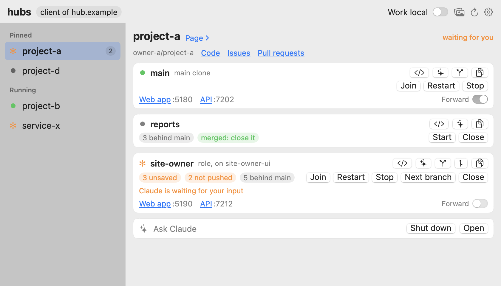
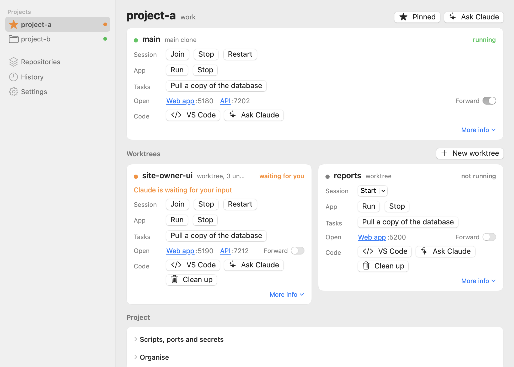
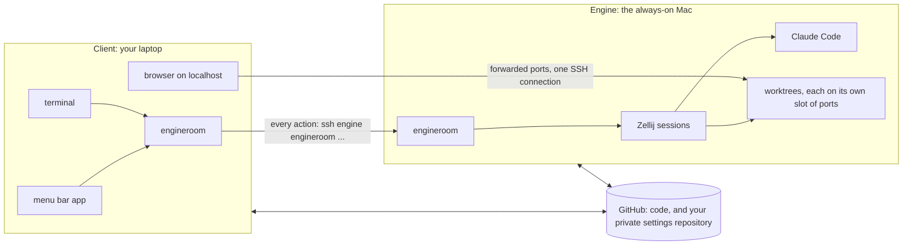

# engineroom

**Keep your Claude Code sessions running on one always-on Mac, and work on them from any other
Mac as if they were local.**

> **Read it as a website.** Everything here, the guide, how it works and every decision, is also
> a website built from this repository. Clone it and run, with Go installed:
>
> ```sh
> go run ./tools/site -serve
> ```
>
> then open <http://localhost:20800/>. With engineroom itself, the repository's own stack runs
> it: `engineroom up` in a session of this repository, and the Website link appears on its card.

`engineroom` is one small Go program, plus a menu bar app, for people who run several Claude Code
sessions at once across several projects and more than one machine. Every session lives inside
[Zellij](https://zellij.dev) on a machine that never sleeps (the **engine**). From your laptop (a
**client**) you see every session, which one is waiting for you, and the app each one is building,
and you join it with one click. Close the laptop and nothing stops. Open it somewhere else and
everything is where you left it.

<p align="center">
  
  &nbsp;
  
</p>

## Why it exists

Claude Code works best when it can run for a long time: a big change, a test suite, a migration,
several pieces of work side by side. A laptop is a poor place for that. It sleeps, it moves
between networks, it runs out of battery, and work started on it is stuck on it.

The obvious answer is a machine that stays on, but working on one from somewhere else is a
pile of small chores: SSH in, find the right tmux or Zellij session, remember which worktree is
which, work out which ports each one's dev server uses, forward them, open the editor over SSH,
and keep your secrets and settings in step between machines. Each chore is easy. Doing all of
them, every time, for every session, is what gets in the way.

`engineroom` does those chores, and shows you exactly how it did them.

## Two ways to use it

**On one Mac: the engine on its own.** Even with no second machine, `engineroom` turns one Mac into a
place where many Claude Code sessions run at once without getting in each other's way. Every
project has a session that survives closing the terminal; new work gets its own worktree, branch,
ports and copy of the project's data; the app each session builds is started and stopped with the
session, so nothing is left holding a port when the work is done; and the menu bar shows which
session is waiting for you. With Claude Code's Remote Control on, the same sessions answer from
your phone or claude.ai while you are away from the desk.

**Across Macs: an engine and its clients.** Put the engine somewhere it can stay on (a Mac mini, a
desktop, a laptop on a shelf) and work from any other Mac as if the sessions were local: the
menu bar lists the engine's sessions, Join opens one in your terminal, VS Code opens its folder over
SSH, and its app answers on your laptop's own `localhost` under the same port numbers. Shut the
laptop, take it home, open it again: the work kept going. Before you go where the engine cannot be
reached (a plane, or the engine off), Work local hands everything over to the laptop, committed work
through GitHub and work in progress straight over SSH, and hands it back again later.

Both are the same program; a machine is set as the engine or a client with one command, and an engine
on its own is simply an engine with no clients yet.

### Reaching the engine from anywhere: Tailscale

A client only needs to reach the engine over SSH. On one network that is the engine's local name. To
work from anywhere, without opening ports on your router or exposing SSH to the internet, put the
engine and your clients on the same [Tailscale](https://tailscale.com) network: each machine gets a
stable private address and a name (with MagicDNS, `engine.your-tailnet.ts.net`) that works at home,
in the office and on hotel Wi-Fi alike. Point the client at that name and everything in `engineroom`
(actions, forwarding, VS Code over SSH, joining a session) travels over it:

```sh
engineroom role set client --engine engine.your-tailnet.ts.net
```

`engineroom` itself has no Tailscale-specific code, and any network that gives the client an SSH route
to the engine works the same way. Tailscale is simply the easiest way to give your laptop that route
from wherever it is.

## What it does

- **Sessions that outlive your laptop.** Each project's Claude Code runs in a Zellij session on
  the engine. Join it from the terminal or the menu bar, leave, and it keeps working.
- **What needs you, marked.** Sessions stay in one order, pinned projects first, and one waiting
  for an answer carries Claude's mark (✻) and its question, through two small Claude Code hooks.
- **Parallel work without collisions.** New work gets its own git worktree on its own branch, its
  own session, and its own **slot** of ports, so three copies of the same app run side by side
  without reaching each other's servers or data.
- **Your app, on your laptop's localhost.** Flip a worktree's Forward switch, or just click one of
  its links, and its ports on the engine answer on the client under the same numbers.
- **Nothing left running behind you.** What a session starts (its app's servers, a dev server
  Claude launched) belongs to that session: stopping the session stops them, and if a session
  ends some other way, the app notices and stops them two minutes later. Leaving a session, or
  closing the window, stops nothing. An editor you opened from it is never touched.
- **One click to anything.** Join, start, stop, run the app's stack, open the folder in VS Code
  (over SSH from a client), or run one of the project's own tasks.
- **Ask Claude.** A button opens a helper session that already knows the project: its worktree,
  ports, scripts, secrets and settings. Say "make the up script seed the database" and it knows
  where everything lives.
- **Settings and secrets that follow you.** Your per-project scripts and settings live in one
  private git repository of your own, with secret files encrypted by git-crypt, so every machine
  is set up the same way.
- **Work local when you must.** On a plane, or with the engine off, a client takes the work over:
  the work each checkout has out is pushed, uncommitted work moves across as a stash, and missing
  projects are cloned, so the laptop can carry on alone and hand back later.
- **Repositories from GitHub.** Browse each GitHub account's repositories, clone or create one,
  and register it in one step.

## How it works



- **One program, two roles.** The same `engineroom` binary runs on every machine; each is configured as
  the engine or a client. On a client, every action is the engine's action, run over SSH.
- **Every action is a list of real commands.** Starting a session, adding a worktree, forwarding
  a port: each is a plan of ordinary shell commands (`git worktree add`, `zellij attach`,
  `ssh -O forward`) that you can read before it runs, watch while it runs, copy and paste, and
  find afterwards in the history. The tool teaches the underlying commands instead of hiding them.
- **Nothing changes unasked.** It reports a problem and shows the fix; it applies a fix only when
  you ask. It stops a session or a process only when you chose that one, never by matching a
  name.
- **Code moves through GitHub.** Committed work moves between engine and client by push and pull,
  and your settings the same way, through a repository of your own. A handover carries work in
  progress straight between the two machines over SSH, so it never reaches GitHub.
- **Quiet when you are not looking.** The menu bar app polls nothing: it keeps one connection to
  the engine, over which the engine sends the sessions only when they change, so the menu bar can show
  Claude's mark while a session waits. Forwarding keeps one SSH connection open only while
  something is forwarded, and hears about new sessions the same way.
- **The menu bar app is a front end, not a second implementation.** It runs `engineroom api ...` for
  everything, so the app, the terminal interface and the command line always agree.

## Quick start

The quickest way in is Claude Code. Add engineroom's plugin, then ask Claude to set this machine up:

```text
/plugin install engineroom --marketplace KyleyHarris/engineroom
```

(Or `/plugin marketplace add KyleyHarris/engineroom`, then `/plugin install engineroom@engineroom`.)
Its `setup-machine` skill installs engineroom when it is missing and walks
[docs/setup.md](docs/setup.md) item by item, changing nothing without asking. Its `adopt-project`
skill then reads a repository of yours and recommends how it runs in worktrees: its ports, its up
and down scripts, its secret files, written to your own settings only when you agree.

By hand: you need macOS, Go, Zellij 0.45 or later, git, OpenSSH and Claude Code on every machine.
[docs/setup.md](docs/setup.md) lists everything an engine or a client needs, why, and how to check
each item.

On every machine, from the same commit:

```sh
scripts/install.sh --app     # builds engineroom into ~/.local/bin and the app into ~/Applications
```

On the engine:

```sh
engineroom role set engine
engineroom project add ~/src/project-a      # register each repository's main clone
engineroom root add ~/src/owner-a --owner owner-a --account account-a   # optional: a GitHub account's repositories
```

On each client, naming the engine as an SSH destination:

```sh
engineroom role set client --engine engine.example
```

Then open **engineroom** from the menu bar, or run `engineroom` in a terminal for the same list.

```sh
engineroom                          # every session; join, start, stop, clean up, history
engineroom open project-a           # start or join a project's session
engineroom new project-a fix-login  # new work: a worktree on a new branch, with its own session and ports
engineroom clean project-a fix-login  # finished: stop it, tear it down, remove the worktree
engineroom forward add project-a-fix-login  # reach that worktree's app on this machine
```

## Learn more

- **[docs/usage.md](docs/usage.md)**: the full guide. Sessions, new work and clean up, your
  settings and secrets, ports and slots, forwarding, GitHub roots, working local, the menu bar
  app, Ask Claude and tasks, VS Code.
- **[docs/setup.md](docs/setup.md)**: setting up an engine or a client, item by item.
- **[docs/decisions.md](docs/decisions.md)**: every design decision, with the problem it solved
  and the options weighed.
- **`acceptance/`**: what the program must do, as Gherkin scenarios, each one proven by an
  end-to-end journey in `journeys/` that drives the real program against a real engine in Docker.

## Status

engineroom is in active development and used every day on an engine and a client. It is built and tested on
macOS. The core is complete: sessions, worktrees and slots, forwarding, settings and secrets,
working local, the menu bar app, Ask Claude and project tasks, and sessions that own what they
start. Health checks are planned.

## Contributing and security

See [CONTRIBUTING.md](CONTRIBUTING.md) and [SECURITY.md](SECURITY.md). Licensed under the
[MIT licence](LICENSE).
